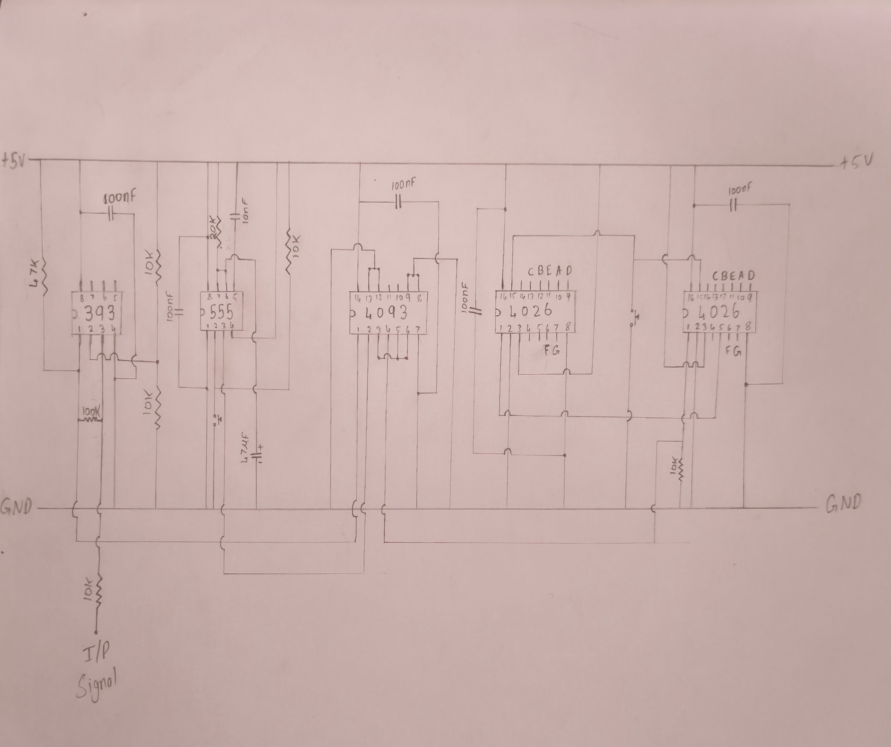

# Digital Frequency Counter

A DIY digital frequency counter built using commonly available analog and digital ICs.

## Overview

This project aims to measure the frequency of an input signal and display the result using seven-segment displays.

The current prototype uses an NE555 timer for generating a 1 Hz timing reference, an LM393 comparator for input signal conditioning, CD4093 logic gates, and CD4026 counter/display driver ICs.

## Prototype

## Hardware Used

- NE555 Timer IC
- LM393 Comparator
- CD4093 IC
- CD4026 ICs
- Seven-segment displays
- Resistors and capacitors

- [Hardware Documentation](Hardware.md)

## Current Status

**Prototype – Under Development**

The current prototype exhibits an approximate positive measurement error of 8 Hz.

## Future Improvements

- Replace the NE555 timing reference with a crystal oscillator.
- Add a third seven-segment display.
- Improve measurement accuracy and stability.

---

*This project is a work in progress. Documentation and circuit improvements will be added as development continues.*
